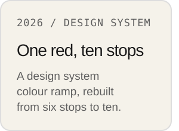
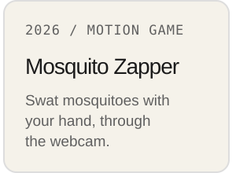
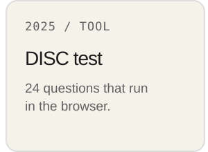
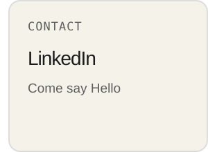
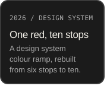
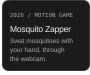
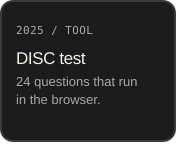
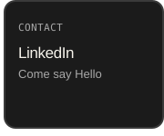

  <picture>
    <source media="(max-width: 600px)" srcset="assets/banner-m-v3.svg">
    <source media="(prefers-color-scheme: dark)" srcset="assets/banner-dark-v2.svg">
    
  </picture>

<a href="https://dofu.github.io/error-ramp/"><picture><source media="(max-width: 600px)" srcset="assets/blank.svg"><source media="(prefers-color-scheme: dark)" srcset="assets/card-ramp-dark-v4.svg"></picture></a><a href="https://dofu.github.io/motion-mosquito-zapper-game/"><picture><source media="(max-width: 600px)" srcset="assets/blank.svg"><source media="(prefers-color-scheme: dark)" srcset="assets/card-game-dark-v4.svg"></picture></a><a href="https://dofu.github.io/disc-test/"><picture><source media="(max-width: 600px)" srcset="assets/blank.svg"><source media="(prefers-color-scheme: dark)" srcset="assets/card-disc-dark-v4.svg"></picture></a><a href="https://www.linkedin.com/in/shingan/"><picture><source media="(max-width: 600px)" srcset="assets/blank.svg"><source media="(prefers-color-scheme: dark)" srcset="assets/card-linkedin-dark-v5.svg"></picture></a><a href="https://dofu.github.io/error-ramp/"><picture><source media="(min-width: 601px)" srcset="assets/blank.svg"></picture></a><a href="https://dofu.github.io/motion-mosquito-zapper-game/"><picture><source media="(min-width: 601px)" srcset="assets/blank.svg"></picture></a><a href="https://dofu.github.io/disc-test/"><picture><source media="(min-width: 601px)" srcset="assets/blank.svg"></picture></a><a href="https://www.linkedin.com/in/shingan/"><picture><source media="(min-width: 601px)" srcset="assets/blank.svg"></picture></a>

