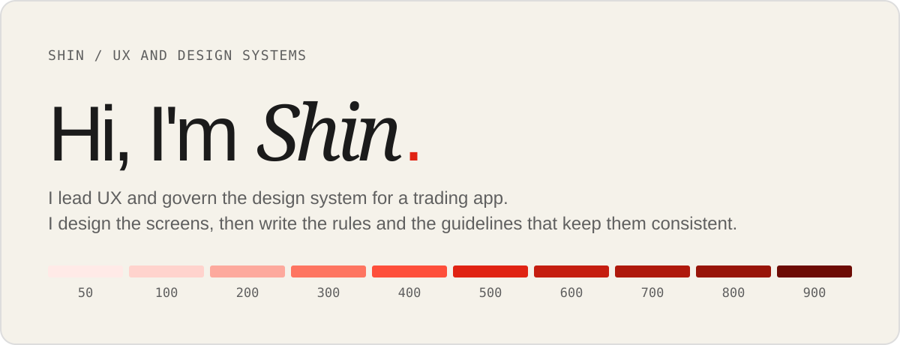
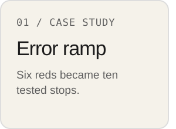
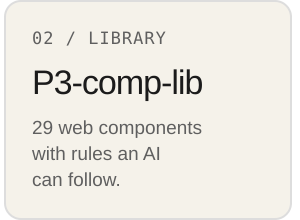
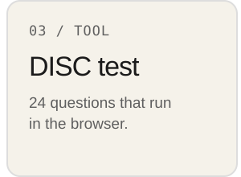

  <picture>
    <source media="(prefers-color-scheme: dark)" srcset="assets/banner-dark-v2.svg">
    
  </picture>

<a href="https://dofu.github.io/error-ramp/"><picture><source media="(prefers-color-scheme: dark)" srcset="assets/card-ramp-dark-v2.svg"></picture></a><a href="https://github.com/dofu/P3-comp-lib"><picture><source media="(prefers-color-scheme: dark)" srcset="assets/card-library-dark-v2.svg"></picture></a><a href="https://dofu.github.io/DISC-test/"><picture><source media="(prefers-color-scheme: dark)" srcset="assets/card-disc-dark-v2.svg"></picture></a>

